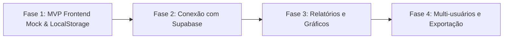

# Product Requirements Document (PRD)
## Projeto: MyFinance — Controle Financeiro para Pequenos Negócios

---

### Metadados do Documento
- **Versão:** 1.0.0
- **Status:** Aprovado / Em Operação Inicial
- **Público-Alvo:** Pequenas Empresas, MEIs, Prestadores de Serviço e Empreendedores Autônomos
- **Data de Criação:** Outubro de 2026

---

## 1. Visão Geral do Produto

### 1.1 Declaração do Problema
Pequenos empreendedores frequentemente enfrentam dificuldades para manter a clareza sobre suas finanças operacionais. Ferramentas existentes de mercado tendem a ser:
- Excessivamente complexas e burocráticas (planilhas densas de ERPs);
- Poluídas visualmente ou lentas;
- Difíceis de manter no dia a dia.

### 1.2 Proposta de Valor
O **MyFinance** é uma aplicação web de controle financeiro moderna, ágil e acolhedora, desenhada especificamente para descomplicar a gestão diária de pequenos negócios. Com uma interface limpa, inspirada em padrões de design de alta conversão (*bento grid*, tipografia fluida e elementos em pílula), o sistema permite que o usuário veja imediatamente sua saúde financeira (saldo, receitas e despesas) e registre movimentações com o mínimo de cliques possível.

---

## 2. Personas do Usuário

### Persona 1: Juliana, 32 anos — Proprietária de Studio Criativo
- **Perfil:** Designer gráfica e prestadora de serviços digitais com faturamento recorrente e pequenos custos mensais (softwares, internet, fornecedores).
- **Necessidade:** Saber rapidamente se o mês fechou positivo e quanto dinheiro líquido tem em caixa hoje para tomar decisões de investimento.
- **Dores:** Não quer perder horas categorizando 50 campos fiscais diferentes; precisa de agilidade no celular ou notebook.

### Persona 2: Marcos, 41 anos — Comerciante / Pequeno Varejista
- **Perfil:** Dono de loja física de acessórios e presentes.
- **Necessidade:** Acompanhar as vendas da semana em comparação com os custos de aluguel e reposição de estoque.
- **Dores:** Falta de familiaridade com sistemas contábeis pesados; necessita de visual intuitivo e com cores claras para receitas (positivo) e saídas (negativo).

---

## 3. Diretrizes de Design & Identidade Visual

O produto segue rigorosamente o guia de estilo visual contido na pasta `app-design/`:

| Elemento | Especificação Técnica |
| :--- | :--- |
| **Tipografia Principal** | **Urbanist** (Google Fonts) nos pesos 400, 500, 600, 700 e 800. |
| **Paleta Base** | Warm off-white / areia suave (`#F4F2EC`) para o fundo global, garantindo baixo cansaço visual. |
| **Hero Card (Saldo)** | Gradiente suave em amarelo-ácido/limão (`#EBFD58` → `#CEF836`) com tipografia preta sólida (`#0F172A`). |
| **Cores Semânticas** | Verde-esmeralda/Teal (`#059669` / `#ECFDF5`) para Receitas e Coral/Rose (`#E11D48` / `#FFF1F2`) para Despesas. |
| **Formas & Bordas** | Cantos amplos arredondados (`border-radius: 24px` a `32px`) e botões/filtros em formato de pílula (`border-radius: 9999px`). |
| **Layout** | *Bento Grid* modular e responsivo com sombras suaves e microinterações de hover. |

---

## 4. Requisitos Funcionais (RF)

### RF01 — Resumo Financeiro em Tempo Real (KPIs)
- **Descrição:** A tela inicial deve apresentar 3 cards principais em destaque:
  - **Saldo Atual em Caixa:** Diferença líquida entre o total de receitas e total de despesas, acompanhado de indicador visual de status (*Saudável*, *Equilibrado* ou *Atenção/Negativo*).
  - **Total de Receitas:** Soma de todas as entradas cadastradas, com contador de itens.
  - **Total de Despesas:** Soma de todas as saídas cadastradas, com contador de itens.
- **Critérios de Aceitação:**
  - Valores formatados segundo o padrão monetário brasileiro `R$ 0,00` (BRL).
  - Atualização instantânea dos cards ao incluir ou excluir qualquer lançamento, sem recarregar a página.

### RF02 — Cadastro de Lançamentos (Receitas e Despesas)
- **Descrição:** Modal acionado pelo botão em destaque `+ Novo Lançamento`.
- **Campos Obrigatórios:**
  - **Tipo:** Alternador visual (Switch Pill) entre *Receita* e *Despesa*.
  - **Descrição:** Texto curto identificando o lançamento (ex: "Venda de Produtos", "Aluguel Comercial").
  - **Valor (R$):** Valor numérico decimal positivo.
  - **Categoria:** Lista suspensa pré-configurada de acordo com o tipo escolhido (ex: Vendas, Serviços, Instalações, Fornecedores, etc.).
  - **Data:** Campo de data com preenchimento padrão da data corrente.
- **Critérios de Aceitação:**
  - Validação de preenchimento (campos obrigatórios e valor > 0).
  - Fechamento do modal via botão cancelar, tecla `Esc` ou clique fora da janela.
  - Foco automático no primeiro campo ao abrir o modal.

### RF03 — Lista de Transações Recentes
- **Descrição:** Painel exibindo as transações ordenadas cronologicamente (da mais recente para a mais antiga).
- **Conteúdo de cada item:**
  - Ícone representativo da categoria.
  - Título / Descrição da operação.
  - Badge de categoria e data formatada por extenso (`18 de out de 2026`).
  - Valor monetário destacado (`+ R$ X,XX` em verde para receitas ou `- R$ X,XX` em vermelho para despesas).
  - Ação de exclusão individual com confirmação.
- **Critérios de Aceitação:**
  - Quando não houver lançamentos que atendam aos filtros, exibir um *Empty State* amigável convidando o usuário ao cadastro.

### RF04 — Filtros e Busca Rápida
- **Descrição:** Barra de ferramentas localizada acima da lista de transações.
- **Critérios de Aceitação:**
  - **Filtros por Aba (Pill Buttons):** Alternar entre *Todas*, *Receitas* e *Despesas* com efeito de seleção visual.
  - **Busca em Tempo Real:** Filtragem instantânea conforme o usuário digita termos da descrição ou da categoria.

### RF05 — Persistência e Mock Data Inicial
- **Descrição:** Na primeira inicialização, carregar um conjunto realista de lançamentos de exemplo para pequenos negócios.
- **Critérios de Aceitação:**
  - Transações novas devem ser persistidas localmente no `localStorage` do navegador para que não se percam ao atualizar a página (F5).
  - Camada de dados isolada para permitir migração transparente para banco de dados backend.

---

## 5. Requisitos Não Funcionais (RNF)

| Identificador | Requisito | Detalhe |
| :--- | :--- | :--- |
| **RNF01** | **Performance** | Carregamento imediato sem dependência de bundles pesados; First Contentful Paint < 0.5s. |
| **RNF02** | **Compatibilidade** | Suporte total aos navegadores modernos (Chrome, Firefox, Safari, Edge) em desktop, tablets e smartphones. |
| **RNF03** | **Responsividade** | Adaptação fluida do layout da sidebar e bento grid para dispositivos móveis (< 992px). |
| **RNF04** | **Acessibilidade** | Elementos com contraste legível, foco navegável por teclado, tags semânticas HTML5 e atributos `aria-*`. |
| **RNF05** | **Manutenibilidade** | Separação clara de responsabilidades (Camada de Estilo CSS, Camada de Armazenamento `storage.js` e Camada de Apresentação `app.js`). |

---

## 6. Arquitetura de Dados & Modelo de Entidade

### 6.1 Estrutura do Objeto `Transaction`
```typescript
interface Transaction {
  id: string;               // Identificador único (ex: 'tx-17292994-a9b2')
  description: string;      // Descrição clara da transação
  amount: number;           // Valor monetário float positivo
  type: 'income' | 'expense'; // Natureza do lançamento
  category: string;         // Categoria de negócio (ex: 'Vendas', 'Marketing')
  date: string;             // Data no formato ISO YYYY-MM-DD
  createdAt: string;        // Timestamp ISO da criação
}
```

---

## 7. Próximas Fases e Roadmap de Evolução



### Fase 2: Integração com Supabase (Backend & Cloud DB)
- Criação das tabelas `profiles` e `transactions` no PostgreSQL do Supabase.
- Configuração de políticas de segurança em nível de linha (Row Level Security - RLS).
- Autenticação de usuários (Magic Link ou Email/Senha).
- Sincronização automática em tempo real (*Supabase Realtime*).

### Fase 3: Recursos Analíticos Avançados
- Gráfico de linha/área com evolução do fluxo de caixa ao longo dos meses.
- Gráfico de rosca (*donut chart*) com distribuição percentual das despesas por categoria.
- Filtro por período personalizado (mês corrente, últimos 3 meses, ano).

### Fase 4: Exportação e Relatórios
- Exportação de lançamentos em formato CSV e PDF para envio à contabilidade.
- Definição de metas de faturamento e limites de gastos por categoria.
